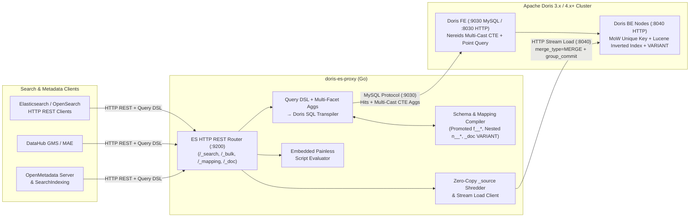

# doris-es-proxy

[](https://github.com/es2doris/doris-es-proxy/actions/workflows/ci.yml)
[](https://github.com/es2doris/doris-es-proxy/actions/workflows/e2e-live-doris.yml)
[](https://goreportcard.com/report/github.com/es2doris/doris-es-proxy)
[](https://opensource.org/licenses/Apache-2.0)

**`doris-es-proxy`** is a stateless, wire-compatible **Elasticsearch / OpenSearch HTTP REST & Query DSL adapter** backed 100% by **Apache Doris** (3.x / 4.x+).

Think **"FerretDB, but for the Elasticsearch HTTP REST API on top of Apache Doris"**: run metadata catalogs like **OpenMetadata** and **DataHub**—as well as legacy ELK search clients—directly against Apache Doris's native `VARIANT` columns, Lucene Inverted Indexes, BM25 scoring, and `UNIQUE KEY` Merge-on-Write tables with **zero Elasticsearch or OpenSearch containers**.

---

## Architecture



## Why `doris-es-proxy`? (TCO & Operational Footprint)

Data platform teams running **OpenMetadata** or **DataHub** on top of Apache Doris are traditionally forced to operate a dedicated 3-node JVM Elasticsearch/OpenSearch cluster just to index metadata entities. `doris-es-proxy` eliminates the second cluster entirely:

| Metric / Component | Traditional Stack (Doris + Elasticsearch Cluster) | Unified Stack (Doris + `doris-es-proxy`) |
| :--- | :--- | :--- |
| **Search JVM Heap / RAM** | **8 GB – 32+ GB RAM** (3x ES/OpenSearch JVM nodes) | **~25 MB RAM** (single stateless Go binary) |
| **Storage Engine & Compaction** | Duplicate Lucene segments + JVM GC pauses | Native Doris MoW `UNIQUE KEY` + Inverted Index + ZSTD `_source` |
| **Catalog & Alias State** | Dedicated ES Master quorum | Stored natively in Doris (`_es_catalog` MoW table) |
| **Nested Array Correlation** | Hidden Lucene child documents (`_nested` join overhead) | Two-stage Doris Inverted Index `array_contains` + `array_exists` lambda |
| **Multi-Facet Sidebar Aggs** | Per-shard global ordinals heap pressure | Single-scan Nereids Multi-Cast CTE (`WITH base_matched AS (...)`) |

---

## Side-by-Side: Elasticsearch Query DSL $\rightarrow$ Apache Doris SQL

Given an OpenMetadata `/_search` request combining full-text `multi_match`, correlated `nested` column predicates (`columns.name = "user_id" AND columns.dataType = "INT"`), `function_score` tier/popularity boosting, and multi-faceted sidebar `aggs`, `doris-es-proxy` compiles:

<table>
<tr>
<th>Elasticsearch HTTP Request (<code>POST /table_search_index/_search</code>)</th>
<th>Transpiled Apache Doris SQL (Nereids)</th>
</tr>
<tr>
<td>

```json
{
  "size": 10,
  "query": {
    "function_score": {
      "query": {
        "bool": {
          "must": [
            {
              "multi_match": {
                "query": "orders",
                "fields": ["name^10", "description^2"]
              }
            },
            {
              "nested": {
                "path": "columns",
                "query": {
                  "bool": {
                    "must": [
                      {"term": {"columns.name": "user_id"}},
                      {"term": {"columns.dataType": "INT"}}
                    ]
                  }
                }
              }
            }
          ],
          "filter": [{"term": {"deleted": false}}]
        }
      },
      "functions": [
        {
          "filter": {"term": {"tier.tagFQN": "Tier.Tier1"}},
          "weight": 3.0
        }
      ]
    }
  },
  "aggs": {
    "serviceType": {"terms": {"field": "serviceType"}},
    "tags": {"terms": {"field": "tags.tagFQN"}}
  }
}
```

</td>
<td>

```sql
-- 1. HitsSQL (Stage-1 Inverted Index + Stage-2 Correlated Lambda)
SELECT `_id`, `_version`, `_source`,
       CAST(((CASE WHEN LOWER(CAST(`f__name` AS STRING)) LIKE LOWER('%orders%')
                   THEN 10 ELSE 0 END) + ...)
            * (CASE WHEN `f__tier__tagFQN` = 'Tier.Tier1' THEN 3 ELSE 1 END)
            AS DOUBLE) AS `_score`,
       COUNT(*) OVER() AS `_total_hits`
FROM `es_compat`.`table_search_index`
WHERE `__DORIS_DELETE_SIGN__` = 0
  AND ((`f__name` MATCH_ANY 'orders' OR `f__description` MATCH_ANY 'orders')
   AND (`n__columns` IS NOT NULL
        AND array_contains(`n__columns__name`, 'user_id')
        AND array_contains(`n__columns__dataType`, 'INT')
        AND array_exists(_el -> (
              json_extract_string(_el, '$.name') = 'user_id'
              AND json_extract_string(_el, '$.dataType') = 'INT'
            ), `n__columns`))
   AND (`f__deleted` = FALSE))
ORDER BY `_score` DESC
LIMIT 10 OFFSET 0;

-- 2. AggsSQL (Single-Scan Nereids Multi-Cast CTE)
WITH `base_matched` AS (
  SELECT * FROM `es_compat`.`table_search_index`
  WHERE `__DORIS_DELETE_SIGN__` = 0 AND (...)
)
SELECT '__meta_total' AS `_agg_name`, '_count' AS `_bucket_key`,
       CAST(COUNT(*) AS DOUBLE) AS `_doc_count` FROM `base_matched`
UNION ALL
SELECT `_agg_name`, `_bucket_key`, `_doc_count` FROM (
  SELECT 'serviceType' AS `_agg_name`, CAST(`f__serviceType` AS STRING) AS `_bucket_key`,
         CAST(COUNT(*) AS DOUBLE) AS `_doc_count`
  FROM `base_matched` WHERE `f__serviceType` IS NOT NULL
  GROUP BY `f__serviceType` ORDER BY `_doc_count` DESC LIMIT 10
) `_agg_sub_1`
UNION ALL
SELECT `_agg_name`, `_bucket_key`, `_doc_count` FROM (
  SELECT 'tags' AS `_agg_name`, CAST(`_elem` AS STRING) AS `_bucket_key`,
         CAST(COUNT(*) AS DOUBLE) AS `_doc_count`
  FROM `base_matched` LATERAL VIEW EXPLODE(`f__tags__tagFQN`) `_t` AS `_elem`
  WHERE `_elem` IS NOT NULL
  GROUP BY `_elem` ORDER BY `_doc_count` DESC LIMIT 10
) `_agg_sub_2`;
```

</td>
</tr>
</table>

---

## Key Capabilities

1. **Hybrid Storage & Exact `_source` Fidelity (`pkg/schema`)**
   - Maps each Elasticsearch index to an Apache Doris `UNIQUE KEY(_id)` Merge-on-Write (`enable_unique_key_merge_on_write = "true"`, `store_row_column = "true"`) table.
   - Persists index mappings, settings (`default_pipeline`, `final_pipeline`), aliases (with `is_write_index`, `filter`, and `routing`), ingest pipelines, and index templates in `es_compat._es_catalog` so multiple `doris-es-proxy` replicas remain **100% stateless across restarts** with zero external Redis/etcd dependencies.
   - Preserves verbatim JSON in `_source` (`STRING` with ZSTD compression) alongside auto-shredded `_doc` (`VARIANT`) for dynamic fields and promoted `f__*` columns with dedicated `USING INVERTED` indexes (`parser = standard | unicode | ngram`, `support_phrase = true`, `lower_case = true`).
   - Preserves cross-field element correlation on Elasticsearch `nested` arrays of objects (`columns: [{"name": "id", "tags": ["PII"]}]`) via **Stage-1 Inverted-Index Bitmap Pre-Filters** (`array_contains(n__columns__name, ...)`) + **Stage-2 Vectorized Correlated Lambdas** (`array_exists(_el -> ..., n__columns)`).

2. **Query DSL, Deep Pagination, Pipeline Aggregations & Multi-Faceted Aggregation Transpiler (`pkg/transpiler`, `pkg/proxy`)**
   - Compiles `bool` (`must`, `filter`, `should`, `must_not`, `minimum_should_match`), `term`, `terms` (including cross-index **Terms Lookup** `{"index", "id", "path"}`), `terms_set` (`minimum_should_match_field` & `minimum_should_match_script`), `ids`, `range` (with ES date math `now-7d/d`), `exists`, `prefix`, `wildcard`, `regexp` (`MATCH_REGEXP`), `fuzzy`, `match`, `match_phrase` (with `~slop` token-distance evaluation), `match_phrase_prefix` (single- and multi-token), `match_bool_prefix`, `multi_match`, `combined_fields`, `query_string` / `simple_query_string` (field groups, `/regex/`, `~N` slop/fuzziness, `[min TO max]`, `_exists_:field`, plus Apache Doris 4.0 `SEARCH()` pushdown), `nested`, `constant_score`, `function_score`, `script_score`, `collapse` (field collapsing via `ROW_NUMBER() OVER (PARTITION BY ...)`), `search_after` keyset pagination, and stateless `POST /_search/scroll` cursors.
   - Compiles multi-faceted `aggs` (`terms` on scalar and `ARRAY<STRING>` columns with `order`, `include`, `exclude`, `min_doc_count`, and `missing` bucket; `significant_terms` & `significant_text`; `nested` & `reverse_nested` aggregations via `LATERAL VIEW EXPLODE`; `date_histogram` with `time_zone`, `offset`, `extended_bounds`, `hard_bounds`, `min_doc_count: 0`; `histogram`; `range`, `date_range`, & `ip_range` CIDR masks; `filter`; named & anonymous `filters` with `other_bucket`; `missing`; `global`; `sampler` & `diversified_sampler`; `composite` with multi-source keyset `after` cursor, `missing_bucket: true`, & `missing_order`; `top_hits`; `top_metrics`; `cardinality`; `value_count`; `stats`; `extended_stats`; `string_stats`; `percentiles`; `percentile_ranks`; `boxplot`; `rate` with `unit` scaling; `avg`; `sum`; `min`; `max`) and 2nd-level multi-bucket sub-aggregations into a single-scan **Nereids Multi-Cast CTE (`WITH base_matched AS (...)`)** query, plus **Sibling & Child Pipeline Aggregations** (`avg_bucket`, `sum_bucket`, `min_bucket`, `max_bucket`, `stats_bucket`, `extended_stats_bucket`, `percentiles_bucket`, `derivative`, `cumulative_sum`, `moving_avg`, `moving_fn` with `shift`, `model`, & `MovingFunctions.*`, `serial_diff`, `normalize`, `bucket_script`, `bucket_selector`, `bucket_sort`).
   - Supports `track_total_hits: false` window-function skip (`CAST(-1 AS BIGINT) AS _total_hits`) and integer thresholds (`relation: "gte"`), plus global wire-level `?filter_path=...` (wildcards `*`, `**`, and `-` exclusions), `?pretty=true`, and `?error_trace=true`.

3. **High-Throughput `/_bulk` Stream Load, Group-Commit Coalescing & Embedded Painless Mutations (`pkg/painless`, `pkg/proxy`)**
   - Streams `/_bulk` NDJSON (`index`, `create`, `update`, `delete` via `__DORIS_DELETE_SIGN__ = 1`, `doc_as_upsert`, `upsert`, `scripted_upsert`) into Doris HTTP Stream Load (`merge_type: MERGE`, `function_column.sequence_col: _version`) while preserving auth headers across FE `:8030` $\rightarrow$ BE `:8040` `307` redirects, with optional **group-commit micro-batch coalescing (`--bulk-coalesce-ms`, `--bulk-coalesce-bytes`)** across concurrent writers, automatic transient retry backoff (`502`/`503`/`504`, `TOO_MANY_VERSIONS`, `MEM_LIMIT_EXCEEDED`), transparent `Content-Encoding: gzip` request decompression, and `Accept-Encoding: gzip` response compression.
   - Optional **bounded TTL Query Result Cache (`--query-cache-ttl`)** accelerates repeated dashboard queries with automatic write/DDL cache invalidation for strict read-your-writes consistency (and automatic bypass on relative `now` date-math queries).
   - Executes `POST /{index}/_update/{id}`, `POST /{index}/_update_by_query`, and `POST /_reindex` using an embedded, bounded Painless script evaluator supporting `ctx._source` property assignments, array index & negative index mutations (`ctx._source.items[0].price = 42`, `ctx._source.tags[-1] = 'last'`), dynamic bracket indexing (`ctx._source[params.field]`), compound operators (`+=`, `-=`, `*=`), `.contains()`, `.containsKey()`, `.get()`, `.size()`, `.isEmpty()`, `String` methods (`.toLowerCase()`, `.toUpperCase()`, `.trim()`, `.replace()`, `.split()`, `.startsWith()`, `.endsWith()`, `.substring()`, `.indexOf()`), null-safe navigation (`?.`), regex operators (`=~`, `==~` with `/.../` and `'...'` literals), `Math.*` functions, ternary `? :`, `if/else`, `for` loops, `ctx.op = "noop" | "delete" | "drop"`, `.remove()`, `.add()`, `.putAll()`, and `.removeIf(x -> ...)` mutations.

4. **Enterprise Security, TLS, FinOps, End-to-End Trace Correlation, Shadow Verification & Auto-Indexing Advisor (`pkg/proxy`)**
   - **Native HTTPS / TLS Server (`--tls-cert`, `--tls-key`)**: Serves TLS 1.2+ with modern AEAD cipher suites when certificate and private key PEM files are configured.
   - **Inbound HTTP Basic Auth & Elasticsearch `ApiKey` / `Bearer` Token Authentication (`--basic-auth-user`, `--basic-auth-pass`, `--api-key`)**: Enforces constant-time (`crypto/subtle.ConstantTimeCompare`) credential verification across all Elasticsearch REST endpoints while exempting Kubernetes liveness/readiness probes (`/healthz`, `/readyz`, `/livez`) and reflecting the authenticated username on `GET /_security/_authenticate`.
   - **Auto-Indexing Advisor (`GET /_doris/slowlog`)**: Tracks query execution latency, **normalized SQL query fingerprints (`hits_sql_normalized`, `aggs_sql_normalized`)**, and unindexed `_doc['...']` `VARIANT` sub-column scans, automatically emitting ready-to-run `ALTER TABLE ... ADD COLUMN ... ADD INDEX ... USING INVERTED` DDL recommendations.
   - **W3C `traceparent` & `X-Opaque-Id` SQL Audit Correlation**: Echoes `traceparent`, `X-Opaque-Id`, and `X-Request-ID` HTTP headers and prepends sanitized `/* traceparent=..., opaque_id=..., request_id=... */` comments to every Doris SQL statement so slow queries in Doris FE `fe.audit.log` correlate directly back to Kibana, Grafana, or application spans.
   - **Dual-Read Shadow Verification (`--shadow-es-url`, `GET /_doris/shadow_stats`)**: Replays `/_search` requests against an existing Elasticsearch/OpenSearch cluster and computes hit-count parity (`doris_total == es_total`), Top-K `_id` Jaccard overlap, and latency speedup factor.
   - **Embedded Interactive Playground (`GET /_doris/ui`)**: Zero-dependency browser UI for side-by-side Elasticsearch Query DSL $\rightarrow$ Apache Doris SQL transpilation, live execution, and DDL inspection.

---

## Elasticsearch REST & Query DSL Compatibility Matrix

| Category | Supported Endpoints & Features | Status |
| :--- | :--- | :--- |
| **Cluster, Auth, Cat & GUI Admin** | `GET /`, `/_cluster/health`, `/_cluster/settings`, `/_cluster/state`, `/_cluster/stats`, `/_nodes`, `/_stats`, `/{index}/_stats`, `/_resolve/index/{name}`, `/{index}/_search_shards`, `/_cat/indices`, `/_cat/aliases`, `/_cat/nodes`, `/_cat/shards`, `/_cat/count`, `/_cat/health`, `/_ilm/policy`, `/_ilm/explain`, `/_ilm/status`, `/_data_stream`, `/_security/_authenticate` (Inbound Basic Auth & `ApiKey` / `Bearer` token middleware), `/_xpack`, `PUT/GET/HEAD/DELETE /{index}`, `/_mapping`, `GET /{index}/_mapping/field/{fields}`, `/_settings`, `/_aliases`, `/{alias}/_rollover`, `/_index_template`, `/_template`, `/_component_template`, `/_ingest/pipeline/{id}`, `POST /_ingest/pipeline/_simulate`, `GET/POST /_field_caps`, `POST /{index}/_terms_enum`, `GET/POST /{index}/_explain/{id}`, `/_validate/query`, `/_analyze`, `/_refresh`, `/_flush`, `/_forcemerge`, `/healthz`, `/readyz`, `/livez`, `/metrics`, `/?filter_path=...`, `/?pretty=true`, `/?error_trace=true`, CORS (`OPTIONS` preflight), `Content-Encoding: gzip`, `vnd.elasticsearch+json; compatible-with=7\|8\|9` | ✅ Supported |
| **Ingestion & Mutations** | `POST /_bulk` (`index`, `create`, `update`, `delete` with `doc_as_upsert`, `upsert`, `scripted_upsert`, per-item failure isolation, batched lookups, `?pipeline=<id>` execution, group-commit Stream Load coalescing `--bulk-coalesce-ms`, transient retry backoff, **Dynamic Mapping Inference** & **Zero-Downtime Scalar-to-Array Promotion**), `PUT/POST/GET/HEAD/DELETE /{index}/_doc/{id}`, `PUT/POST /{index}/_create/{id}`, `GET/HEAD /{index}/_source/{id}`, `POST /_mget`, `POST /{index}/_update/{id}`, `POST /{index}/_update_by_query`, `POST /{index}/_delete_by_query`, `POST /_reindex` (`?pipeline=<id>`, `dest.op_type: "create"`, `conflicts: "proceed"`, cross-tenant write-alias conflict guard), Ingest Pipelines (`set`, `remove`, `rename`, `lowercase`, `uppercase`, `trim`, `split`, `join`, `append`, `convert`, `gsub`, `json`, `kv`, `dot_expander`, `urldecode`, `bytes`, `html_strip`, `dissect`, `pipeline`, `foreach`, `fail`, `default`, `script`, `drop` with `"result": "noop"` write suppression, `date`, `ignore_failure`, `ignore_missing`, processor & pipeline `on_failure`, `_simulate?verbose=true`, Mustache `{{...}}` templates & `"if"` conditionals) | ✅ Supported |
| **Full-Text & Term DSL** | `bool`, `dis_max`, `boosting`, `match` (+ `ip` CIDR masks), `match_phrase` (+ `slop` & `ip` CIDR masks), `match_phrase_prefix` (single- & multi-token), `match_bool_prefix`, `multi_match`, `combined_fields`, `query_string` (+ field groups, `/regex/`, `~N`, `[min TO max]`, CIDR & IPv4 ranges, `_exists_:field`), `simple_query_string`, `term` (+ `case_insensitive` & `ip` CIDR masks across scalar, array, & `nested` subfields), `terms` (+ CIDR masks & cross-index **Terms Lookup** `{"index","id","path"}`), `terms_set` (`minimum_should_match_field` & `minimum_should_match_script`), `ids`, `range` (+ date math & `ip` numeric IPv4 bounds), `exists`, `prefix`, `wildcard`, `regexp`, `fuzzy` | ✅ Supported |
| **Advanced Search & Scoring** | Vector / kNN search (`dense_vector`, `knn_vector` $\rightarrow$ Doris `ARRAY<STRING>` / `ARRAY<FLOAT>` + `COSINE_DISTANCE` / `L2_DISTANCE` / `INNER_PRODUCT`, top-level `knn`, `query.knn`, hybrid `query` + `knn`), correlated `nested` queries (with per-hit `inner_hits` & `_nested` offset metadata), `function_score` (`field_value_factor`, `weight`, `score_mode`, `boost_mode`), `script_score`, `constant_score`, `post_filter`, `_source` filtering (`includes`/`excludes` with wildcards & `RawSource` preservation), `fields` & `docvalue_fields` (`epoch_millis`, `epoch_second`, ISO-8601, per-hit index schema resolution), `highlight` (including `"*"` wildcard), `collapse` (with `fields`, null preservation, & single/multi `inner_hits`), `sort` (including `_doc` tie-breaker, custom `missing` fallback, & numeric IPv4 ordering), `search_after` (null-safe & numeric IPv4 keyset pagination), `track_total_hits` (`false`, `true`, integer threshold), Point-in-Time (`POST /{index}/_pit`, `DELETE /_pit`), stateless `/_search/scroll`, `/_msearch`, `/_count` | ✅ Supported |
| **Aggregations, Sub-Aggs & Pipeline Aggs** | `terms` (scalar, array, multi-criterion `order`, `include`, `exclude`, `min_doc_count`, & `missing` bucket), `significant_terms` & `significant_text` (JLH mutual-information scoring), `nested` & `reverse_nested`, `date_histogram` & `histogram` (with `time_zone`, `offset`, `extended_bounds`, `hard_bounds` & `min_doc_count: 0` zero-filling), `range`, `date_range` (+ date math), `ip_range` (IPv4 range & CIDR `mask`), `filter`, `filters` (named & anonymous multi-bucket + `other_bucket`), `missing`, `global` (alias-filter-aware), `sampler` & `diversified_sampler`, `composite` (multi-column keyset pagination with `after` cursor, `missing_bucket`, `missing_order`, multi-valued array source `EXPLODE`, & metric/pipeline sub-aggregations), `top_hits`, `top_metrics`, `cardinality`, `value_count`, `stats`, `extended_stats` (`sigma`, `sum_of_squares`, `std_deviation_bounds`, `missing` fallback), `string_stats`, `percentiles`, `percentile_ranks`, `boxplot`, `rate` (with `unit` scaling), `avg`, `sum`, `min`, `max` (null-safe on empty sets & `missing` fallback), **Multi-level Sub-Aggregations** (including 2nd-level `date_histogram`, `histogram`, `range`, `ip_range`, `filters`, `nested`), plus **Pipeline Aggregations** (`avg_bucket`, `sum_bucket`, `min_bucket`, `max_bucket`, `stats_bucket`, `extended_stats_bucket`, `percentiles_bucket`, `derivative`, `cumulative_sum`, `moving_avg`, `moving_fn`, `serial_diff`, `normalize`, `bucket_script` inside multi-bucket & single-bucket aggs, `bucket_selector`, `bucket_sort` with `gap_policy`) | ✅ Supported |
| **Doris Introspection & FinOps** | `GET /_doris/ui` (Interactive Workbench + 1-Click Demo Seed + 1-Click Auto-Promote), `POST /{index}/_doris/explain`, `GET /{index}/_doris/ddl`, `GET /_doris/slowlog` (Auto-Indexing Advisor + Normalized SQL Fingerprints), `POST /{index}/_doris/promote` (Live Column + Inverted Index Promotion + existing document backfill + `--auto-promote`), `GET /_doris/shadow_stats` (`--shadow-es-url`), bounded TTL query cache (`--query-cache-ttl`), `?doris_explain=true`, `doris-es-proxy transpile`, `doris-es-proxy ddl`, `doris-es-proxy doctor`, `doris-es-proxy migrate-schema` | ✅ Supported |

---

## Transpiler & Shredder Micro-Benchmarks

Run `nix develop -c make bench` (`go test -bench=. -benchmem ./...`) to reproduce:

| Benchmark | Latency (`ns/op`) | Throughput | Memory (`B/op`) | Allocations (`allocs/op`) |
| :--- | :--- | :--- | :--- | :--- |
| `BenchmarkTranspiler_OpenMetadataTableSearch` (Full-Text + Correlated `nested` + `function_score` + 3 Multi-Facet CTE `aggs`) | **~20.5 µs** | **~48,700 plans/sec/core** | 19.6 KB | 290 |
| `BenchmarkShredDocument_OpenMetadataTable` (Promoted scalars + `ARRAY<STRING>` + correlated `nested` arrays + `_doc` `VARIANT`) | **~9.7 µs** | **~103,000 docs/sec/core** | 11.4 KB | 124 |

## CLI Reference (Flags, Environment Variables & Subcommands)

### Subcommands
| Subcommand | Description | Example |
| :--- | :--- | :--- |
| `doris-es-proxy transpile` | Offline ES Query DSL $\rightarrow$ Apache Doris `HitsSQL` + `AggsSQL` transpiler | `doris-es-proxy transpile --index logs --mapping mapping.json --query query.json` |
| `doris-es-proxy ddl` | Offline ES `_mapping` $\rightarrow$ Apache Doris `CREATE TABLE` DDL compiler | `doris-es-proxy ddl --index logs --db es_compat --mapping mapping.json` |
| `doris-es-proxy doctor` | Live Apache Doris FE/BE connectivity, version, & inverted-index readiness checker | `doris-es-proxy doctor --doris-dsn "..." --doris-http "http://127.0.0.1:8030"` |
| `doris-es-proxy migrate-schema` | Live Elasticsearch cluster $\rightarrow$ Apache Doris `CREATE TABLE` DDL & template exporter | `doris-es-proxy migrate-schema --es-url "http://es:9200" --db es_compat --out-dir ./ddl` |
| `doris-es-proxy version` | Print `doris-es-proxy` version | `doris-es-proxy version` |

### Server Flags & Environment Variables
| Flag | Env Var | Default | Description |
| :--- | :--- | :--- | :--- |
| `--listen` | `LISTEN_ADDR` | `:9200` | Elasticsearch HTTP/HTTPS REST listen address |
| `--doris-dsn` | `DORIS_DSN` | `root:@tcp(127.0.0.1:9030)/...` | Apache Doris FE MySQL wire protocol DSN |
| `--doris-http` | `DORIS_HTTP` | `http://127.0.0.1:8030` | Apache Doris FE HTTP endpoint for Stream Load |
| `--doris-user` | `DORIS_USER` | `root` | Apache Doris username |
| `--doris-password` | `DORIS_PASSWORD` | `""` | Apache Doris password |
| `--doris-db` | `DORIS_DB` | `es_compat` | Target Apache Doris database name |
| `--doris4-search-fn` | `DORIS4_SEARCH_FN` | `false` | Push `query_string` down to Apache Doris 4.0 `SEARCH()` SQL function |
| `--auto-promote` | `AUTO_PROMOTE` | `false` | Auto-promote hot unindexed `_doc[...]` `VARIANT` fields to `f__*` inverted index columns |
| `--bulk-coalesce-ms` | `BULK_COALESCE_MS` | `0` | Group-commit Stream Load micro-batch window in milliseconds (`0` disables) |
| `--bulk-coalesce-bytes` | `BULK_COALESCE_BYTES` | `8388608` | Maximum byte size of a coalesced Stream Load batch before immediate flush |
| `--query-cache-ttl` | `QUERY_CACHE_TTL` | `0s` | Bounded TTL search response cache with automatic write invalidation (`0s` disables) |
| `--basic-auth-user` | `BASIC_AUTH_USER` | `""` | Optional inbound HTTP Basic Auth username |
| `--basic-auth-pass` | `BASIC_AUTH_PASS` | `""` | Optional inbound HTTP Basic Auth password |
| `--api-key` | `API_KEY` | `""` | Optional inbound Elasticsearch `ApiKey` / `Bearer` token |
| `--tls-cert` | `TLS_CERT_FILE` | `""` | Optional TLS server certificate PEM file for native HTTPS |
| `--tls-key` | `TLS_KEY_FILE` | `""` | Optional TLS private key PEM file for native HTTPS |
| `--shadow-es-url` | `SHADOW_ES_URL` | `""` | Optional legacy Elasticsearch URL for dual-read shadow parity verification |
| `--in-memory` | `IN_MEMORY` | `false` | Run with in-memory shredded Doris emulator (zero external dependencies) |
| `--log-sql` | `LOG_SQL` | `false` | Log transpiled Apache Doris DDL, Stream Load, `HitsSQL`, and `AggsSQL` |

## Architectural Scope & Known Trade-offs

| Area | `doris-es-proxy` + Apache Doris Behavior | When to Keep Dedicated Elasticsearch |
| :--- | :--- | :--- |
| **Primary Workload Fit** | Metadata catalogs (**OpenMetadata**, **DataHub**), observability/log search, and hybrid analytical + full-text + vector workloads already running Apache Doris. | Applications relying on custom Java Elasticsearch plugins or custom TokenFilters. |
| **Relevance Scoring** | Combines Doris Inverted Index predicates (`MATCH_ANY` / `MATCH_ALL` / `MATCH_PHRASE`) with deterministic field-weighted SQL scoring, `function_score`, and vector distance (`COSINE_DISTANCE` / `L2_DISTANCE` / `INNER_PRODUCT`). | Workloads requiring custom Lucene `Similarity` classes or custom `script_score` Java plugins. |
| **Aggregation Depth** | Supports top-level, 1-level, and nested multi-level sub-aggregations (`date_histogram` / `terms` / `range` / `filters` / `nested` $\rightarrow$ `terms` $\rightarrow$ metrics, `boxplot`, `percentile_ranks`, `string_stats`, `top_hits`, `top_metrics`, and pipeline aggregations) in a single Nereids Multi-Cast CTE scan. | Arbitrary unbounded $N$-level deep recursive bucket trees or Holt-Winters seasonal forecasting. |
| **Painless Scripting** | Embedded bounded AST interpreter supporting document mutations (`ctx._source.*`, `if/else`, `for`, `?.` null-safe chaining, `=~` / `==~` regex matching, `putAll`, `addAll`, `removeIf`, `ctx.op`) for `_update`, `_update_by_query`, and `_reindex`. | Full JVM Painless bytecode compilation or arbitrary `java.time.*` class reflection. |

---

## Quick Start

### 1. Instant Interactive Demo (Zero Docker Required)

Run the end-to-end OpenMetadata search, correlated `nested` column filter, sidebar `aggs`, Painless mutation, and `/_doris/explain` walkthrough in 2 seconds using the built-in `--in-memory --log-sql` mode:

```bash
nix develop -c make demo
# or directly:
bash examples/quickstart.sh
```

### 2. Inspect Transpiled Doris SQL Offline (`transpile` & `ddl` CLI or `?_doris/explain`)

You can transpile any Elasticsearch `/_search` or mapping JSON directly from your terminal with zero server startup:

```bash
# Compile an Elasticsearch _search payload to Apache Doris HitsSQL + AggsSQL:
echo '{"query":{"match":{"name":"orders"}},"aggs":{"by_svc":{"terms":{"field":"serviceType"}}}}' \
  | ./bin/doris-es-proxy transpile --index table_search_index

# Generate the Apache Doris UNIQUE KEY Merge-on-Write CREATE TABLE DDL from an ES mapping:
echo '{"mappings":{"properties":{"name":{"type":"text"},"serviceType":{"type":"keyword"}}}}' \
  | ./bin/doris-es-proxy ddl --index table_search_index
```

Or pass `?doris_explain=true` on any live `POST /{index}/_search` request (or call `POST /{index}/_doris/explain`) to inspect the compiled `hits_sql`, `aggs_sql`, `create_table_ddl`, and `field_bindings` directly in the JSON response.

### 3. Run with a Live Apache Doris Cluster (Docker Compose)

```bash
docker compose up -d --build
ES_URL=http://127.0.0.1:9200 bash examples/quickstart.sh
```

### 4. Build, Benchmark, Fuzz & Run Tests

```bash
nix develop -c make check
nix develop -c make security
nix develop -c make bench
nix develop -c make fuzz
nix develop -c make build
./bin/doris-es-proxy --listen :9200 --doris-http http://127.0.0.1:8030 --doris-db es_compat --log-sql
```

### 5. Deploy on Kubernetes with Helm

```bash
helm upgrade --install doris-es-proxy ./deploy/helm/doris-es-proxy \
  --namespace doris-search --create-namespace \
  --set doris.feHost="doris-fe.doris.svc" \
  --set doris.database="es_compat" \
  --set doris.bulkCoalesceMs=50 \
  --set doris.queryCacheTTL="5s" \
  --set auth.basicAuthUser="elastic" \
  --set auth.basicAuthPass="changeme"
```

### 6. Kubernetes, Helm Chart, Observability & Apache Doris DSIP

- **Helm Chart (HPA, PDB, Secret DSN, Prometheus `ServiceMonitor`)**: [`deploy/helm/doris-es-proxy`](deploy/helm/doris-es-proxy)
- **Grafana Dashboard & Prometheus `PrometheusRule` Alerts**: [`deploy/grafana/doris-es-proxy-dashboard.json`](deploy/grafana/doris-es-proxy-dashboard.json) & [`deploy/grafana/prometheus-alerts.yaml`](deploy/grafana/prometheus-alerts.yaml)
- **Kubernetes Standalone Manifests**: [`deploy/kubernetes/doris-es-proxy.yaml`](deploy/kubernetes/doris-es-proxy.yaml)
- **Apache Doris Improvement Proposal (DSIP)**: [`docs/dsip-doris-es-proxy.md`](docs/dsip-doris-es-proxy.md)
- **OpenMetadata & DataHub Configurations**: [`examples/README.md`](examples/README.md)

## License

Licensed under the [Apache License, Version 2.0](LICENSE).
