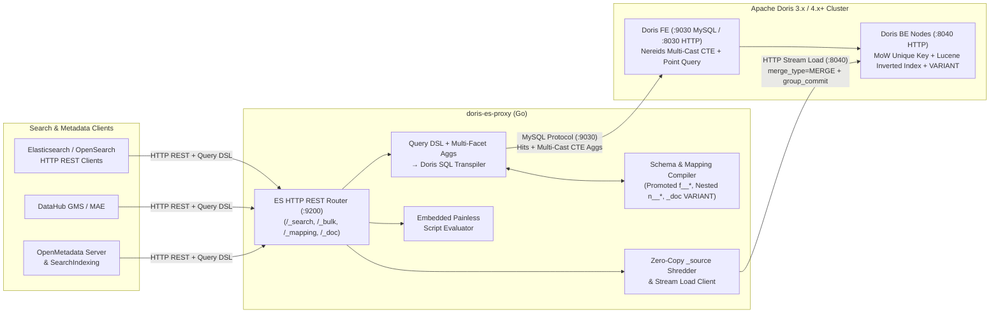

# doris-es-proxy

[](https://github.com/es2doris/doris-es-proxy/actions/workflows/ci.yml)
[](https://opensource.org/licenses/Apache-2.0)

**`doris-es-proxy`** is a stateless, wire-compatible **Elasticsearch / OpenSearch HTTP REST & Query DSL adapter** backed 100% by **Apache Doris** (3.x / 4.x+).

Think **"FerretDB, but for the Elasticsearch HTTP REST API on top of Apache Doris"**: run metadata catalogs like **OpenMetadata** and **DataHub**—as well as legacy ELK search clients—directly against Apache Doris's native `VARIANT` columns, Lucene Inverted Indexes, BM25 scoring, and `UNIQUE KEY` Merge-on-Write tables with **zero Elasticsearch or OpenSearch containers**.

---

## Architecture



## Key Capabilities

1. **Hybrid Storage & Exact `_source` Fidelity (`pkg/schema`)**
   - Maps each Elasticsearch index to an Apache Doris `UNIQUE KEY(_id)` Merge-on-Write (`enable_unique_key_merge_on_write = "true"`, `store_row_column = "true"`) table.
   - Preserves verbatim JSON in `_source` (`STRING` with ZSTD compression) alongside auto-shredded `_doc` (`VARIANT`) for dynamic fields and promoted `f__*` columns with dedicated `USING INVERTED` indexes (`parser = standard | unicode | ngram`, `support_phrase = true`, `lower_case = true`).
   - Preserves cross-field element correlation on Elasticsearch `nested` arrays of objects (`columns: [{"name": "id", "tags": ["PII"]}]`) via **Stage-1 Inverted-Index Bitmap Pre-Filters** (`array_contains(n__columns__name, ...)`) + **Stage-2 Vectorized Correlated Lambdas** (`array_exists(_el -> ..., n__columns)`).

2. **Query DSL & Multi-Faceted Aggregation Transpiler (`pkg/transpiler`)**
   - Compiles `bool` (`must`, `filter`, `should`, `must_not`, `minimum_should_match`), `term`, `terms`, `ids`, `range`, `exists`, `prefix`, `wildcard`, `regexp` (`MATCH_REGEXP`), `match`, `match_phrase` (with `~slop`), `match_phrase_prefix`, `multi_match` (with wildcard field boost expansion), `query_string` / `simple_query_string` (plus Apache Doris 4.0 `SEARCH()` pushdown), `nested`, `constant_score`, and `function_score` (`field_value_factor` with `log1p`/`ln1p`/`sqrt`/`reciprocal`, `filter` weights, `score_mode`, `boost_mode`).
   - Compiles multi-faceted sidebar `aggs` (`terms` on scalar and `ARRAY<STRING>` columns, `nested` aggregations via `LATERAL VIEW EXPLODE`, `filter`, and `missing`) into a single-scan **Nereids Multi-Cast CTE (`WITH base_matched AS (...)`)** query.

3. **High-Throughput `/_bulk` Stream Load & Embedded Painless Mutations (`pkg/painless`, `pkg/proxy`)**
   - Streams `/_bulk` NDJSON (`index`, `create`, `update`, `delete` via `__DORIS_DELETE_SIGN__ = 1`) into Doris HTTP Stream Load (`merge_type: MERGE`) with `group_commit` (`sync_mode` when `?refresh=true`, `async_mode` by default) while preserving auth headers across FE `:8030` $\rightarrow$ BE `:8040` `307` redirects.
   - Executes `POST /{index}/_update/{id}` and `POST /{index}/_update_by_query` using an embedded Painless script evaluator supporting OpenMetadata and DataHub's `ctx._source` property assignments, `.remove()`, `.add()`, and `.removeIf(x -> ...)` mutations.

## Quick Start

```bash
nix develop -c go test -race ./... -v
nix develop -c go build -o doris-es-proxy ./cmd/doris-es-proxy
./doris-es-proxy --listen :9200 --doris-http http://127.0.0.1:8030 --doris-db es_compat
```

## License

Licensed under the [Apache License, Version 2.0](LICENSE).
